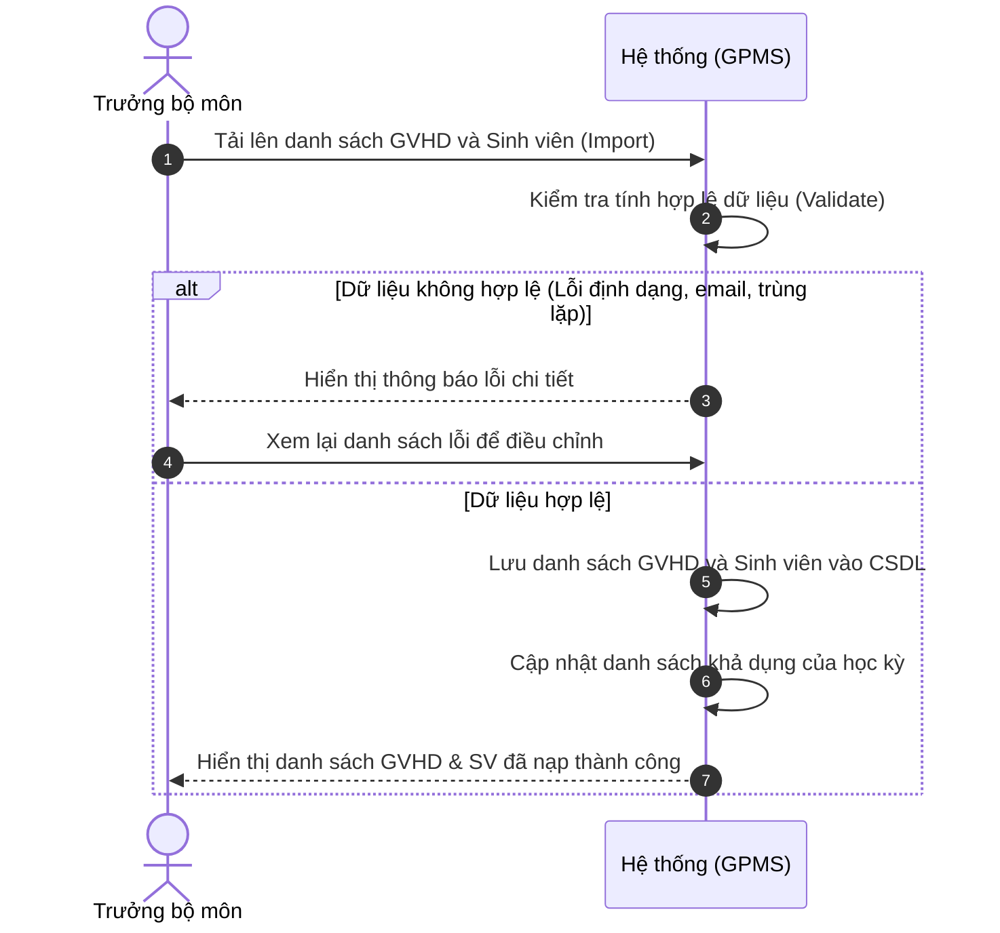
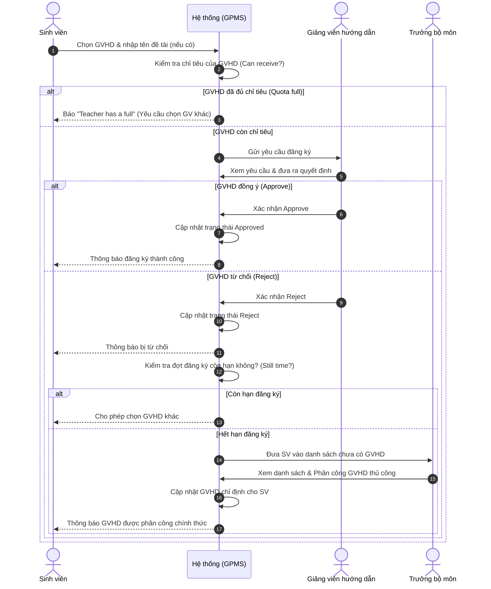
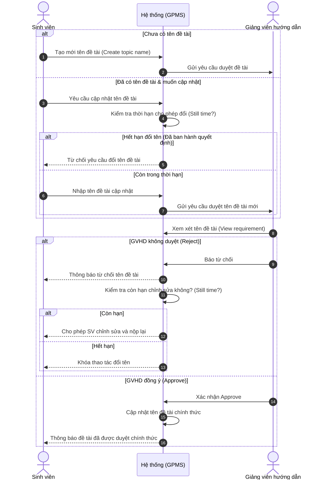
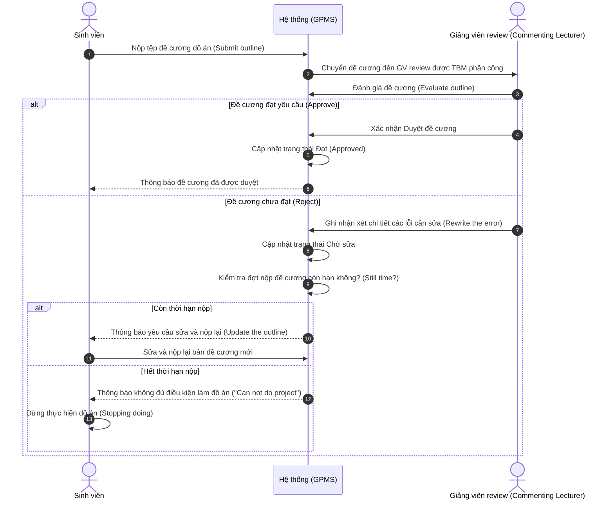
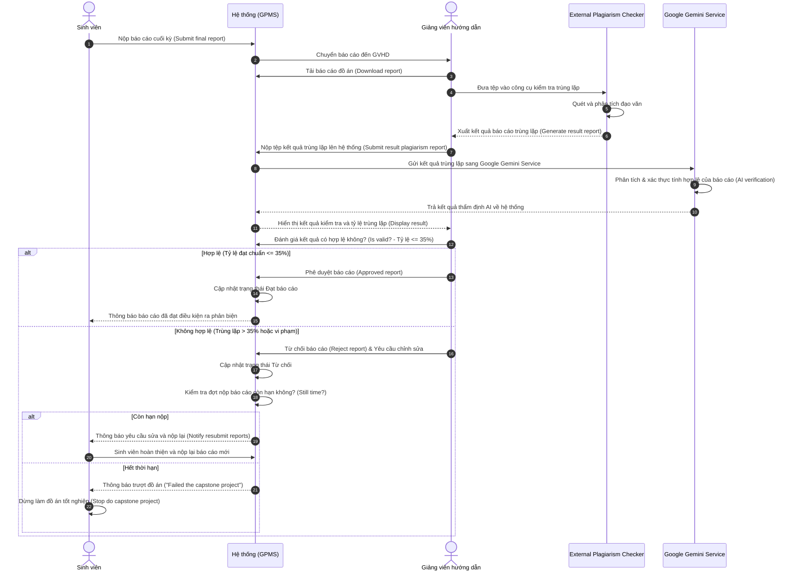
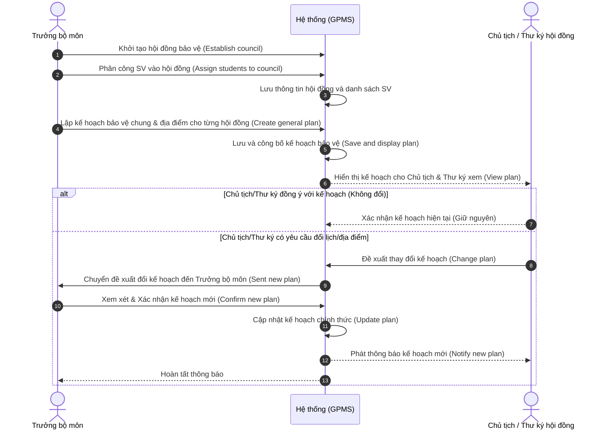
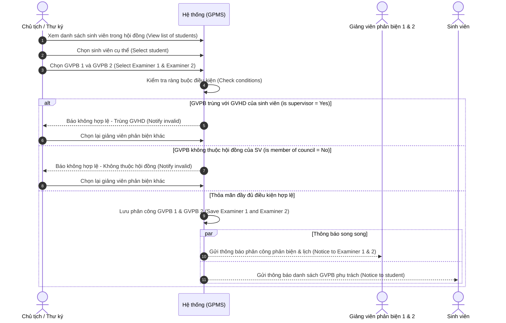
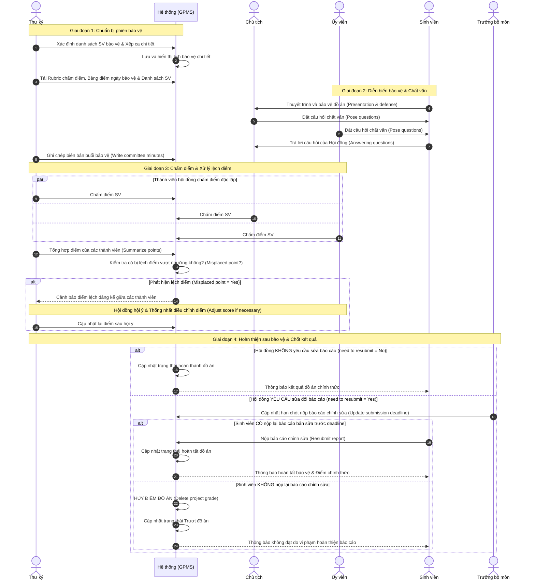

# Hệ thống quản lý đồ án tốt nghiệp

Hệ thống hỗ trợ quản lý toàn bộ quy trình đồ án tốt nghiệp: từ khởi tạo học kỳ,
đăng ký sinh viên và giảng viên, phân công hướng dẫn, xét duyệt đề cương, nộp
báo cáo, tổ chức bảo vệ cho đến chốt kết quả.

Tài liệu này mô tả **luồng nghiệp vụ mục tiêu** dựa trên yêu cầu hiện tại.
Frontend đang được phát triển bằng Vite, React và TypeScript trong thư mục
[`Frontend/`](./Frontend/). Các màn hình và repository dữ liệu demo hiện chạy
trên trình duyệt; những chức năng cần backend, gửi email, xử lý Excel/PDF,
xác thực tệp, real-time và phân quyền bảo mật cần được tích hợp hoàn chỉnh
trước khi đưa vào vận hành thực tế.

## 1. Vai trò trong hệ thống

| Vai trò | Trách nhiệm chính |
| --- | --- |
| **Admin** | Quản lý tài khoản, phân quyền, trạng thái tài khoản và học kỳ. |
| **Trưởng bộ môn (TBM)** | Quản lý danh sách sinh viên/giảng viên, lịch trình, phân công và hội đồng; theo dõi tiến độ; xuất/import hồ sơ; nhắc việc và xem thống kê. |
| **Sinh viên (SV)** | Đăng ký GVHD và đề tài, nộp đề cương/báo cáo, theo dõi người phụ trách, lịch và kết quả; hoàn thiện báo cáo sau bảo vệ nếu được yêu cầu. |
| **Giảng viên hướng dẫn (GVHD)** | Xử lý đăng ký hướng dẫn, duyệt tên đề tài, theo dõi sinh viên, tải/nộp hồ sơ hướng dẫn, đánh giá tiến trình và kiểm tra tỷ lệ trùng lặp báo cáo cuối. |
| **Giảng viên nhận xét/review đề cương** | Đánh giá đề cương được TBM phân công, ghi nhận xét khi từ chối và hoàn tất đánh giá đúng hạn. |
| **Giảng viên phản biện (GVPB)** | Nhận phân công phản biện, lập lịch phản biện, đánh giá và nộp phiếu nhận xét. |
| **Thành viên hội đồng** | Chấm điểm phần việc của mình tại buổi bảo vệ. Chủ tịch và Thư ký có quyền xem bảng điểm tổng hợp theo thời gian thực; Ủy viên chỉ xem màn hình chấm điểm của chính mình. |
| **Thư ký hội đồng** | Ngoài nhiệm vụ thành viên hội đồng, quản lý biên bản, theo dõi hồ sơ và xác nhận việc nộp báo cáo chỉnh sửa sau bảo vệ. |
| **Chủ tịch hội đồng** | Xem thông tin hội đồng, danh sách SV, lịch và tổng hợp điểm; phối hợp với Thư ký trong điều hành buổi bảo vệ. |

Một giảng viên có thể đảm nhiệm nhiều vai trò nghiệp vụ tùy phân công. Việc
được nhìn thấy một nút hoặc một màn hình trên giao diện không thay thế kiểm tra
quyền ở backend.

## 2. Luồng tổng thể và Các luồng nghiệp vụ chính (Main Business Flows)

```text
Admin khởi tạo tài khoản và học kỳ
                 |
TBM nhập danh sách SV/GV (BF-01) và thiết lập lịch trình, thời hạn
                 |
SV đăng ký GVHD & đề tài (BF-02, BF-03) <----> GVHD Approve/Reject
                 |                                      |
                 +-- Hết hạn, SV chưa có GVHD --------> TBM phân công thủ công
                 |
SV nộp đề cương --> Phân công GV review --> GV review Approve/Reject (BF-04)
                                                   |             |
                                             Approve          Reject
                                                   |             |
                                  TBM xuất danh sách  SV sửa và nộp lại (nếu còn hạn)
                                  xin chữ ký Hiệu trưởng  (Hết hạn -> Dừng làm đồ án)
                                                   |
                                     Đủ điều kiện làm đồ án
                                                   |
SV nộp báo cáo cuối --> GVHD quét trùng lặp + Gemini AI kiểm tra (BF-05)
                                                   |
                          TBM lập hội đồng, phân SV và lên lịch chung (BF-06)
                                                   |
                Thư ký/Chủ tịch phân 2 GVPB thuộc hội đồng
                                                   |
GVPB lập lịch và nộp phiếu nhận xét --> Đủ điều kiện ra bảo vệ (Cả 2 Approve)
                                                   |
                       Hội đồng chấm điểm và hoàn tất biên bản
                                                   |
                 SV nộp bản sửa (nếu được yêu cầu) --> Chốt kết quả
```

---

### 2.1 Import danh sách GVHD và sinh viên đủ điều kiện (BF-01)

- **Kích hoạt (Trigger):** Trưởng bộ môn (Head of Department) bắt đầu công tác chuẩn bị cho đợt đồ án tốt nghiệp mới.
- **Điều kiện kết thúc (End condition):** Danh sách sinh viên đủ điều kiện và danh sách giảng viên hướng dẫn khả dụng được tạo/import thành công và sẵn sàng trên hệ thống.
- **Phân vai (Swimlanes):** Trưởng bộ môn, Hệ thống (GPMS).



**Các bước xử lý chi tiết:**
1. **Trưởng bộ môn** chọn tệp và tải lên danh sách sinh viên đủ điều kiện cùng danh sách giảng viên hướng dẫn.
2. **Hệ thống** kiểm tra tính hợp lệ (`Check information`): định dạng tệp, email miền `.edu`, kiểm tra trùng lặp trong tệp và trong CSDL.
3. Nếu **Không hợp lệ (`No`)**: Hệ thống hiển thị thông báo lỗi (`Display error message`), Trưởng bộ môn xem danh sách để chỉnh sửa lại tệp gốc.
4. Nếu **Hợp lệ (`Yes`)**: Hệ thống lưu vào cơ sở dữ liệu (`Save supervisor and student list`), cập nhật trạng thái hoạt động (`Update supervisor and student list`), và hiển thị danh sách hoàn chỉnh cho Trưởng bộ môn (`View supervisor and student list`).

---

### 2.2 Đăng ký và phân công GVHD (BF-02)

- **Kích hoạt (Trigger):** Đợt đăng ký GVHD được mở, sinh viên đủ điều kiện bắt đầu đăng ký nguyện vọng.
- **Điều kiện kết thúc (End condition):** Tất cả sinh viên đủ điều kiện đều đã đăng ký được GVHD thành công hoặc được Trưởng bộ môn phân công chỉ định sau khi hết hạn đăng ký.
- **Phân vai (Swimlanes):** Sinh viên, Hệ thống (GPMS), Giảng viên hướng dẫn (Supervisor), Trưởng bộ môn (Head of Department).



**Các bước xử lý chi tiết:**
1. **Sinh viên** chọn GVHD và nhập tên đề tài dự kiến (nếu có).
2. **Hệ thống** kiểm tra chỉ tiêu nhận của giảng viên (`Check the supervisor still accept`):
   - Nếu **Đầy chỉ tiêu (`No`)**: Báo "Teacher has a full", sinh viên quay lại màn hình đăng ký để chọn giảng viên khác.
   - Nếu **Còn chỉ tiêu (`Yes`)**: Gửi yêu cầu đến GVHD (`Sent request`).
3. **GVHD** xem yêu cầu (`View registration requirements`) và đưa ra quyết định (`Approve?`):
   - **Đồng ý (`Yes`)**: Cập nhật trạng thái `Approved`, gửi thông báo đến sinh viên (`Notice to student`). Kết thúc luồng đăng ký của sinh viên.
   - **Từ chối (`No`)**: Cập nhật trạng thái `Reject`, gửi thông báo đến sinh viên.
4. **Hệ thống** kiểm tra thời hạn đợt đăng ký (`Still time?`):
   - Nếu **Còn hạn (`Yes`)**: Sinh viên quay lại bước 1 để chọn giảng viên khác.
   - Nếu **Hết hạn (`No`)**: Đơn chuyển sang luồng xử lý của Trưởng bộ môn.
5. **Trưởng bộ môn** xem danh sách sinh viên chưa có người hướng dẫn (`View the list assigned supervisors`) và thực hiện phân công giảng viên thủ công (`Assignment supervisor`).
6. **Hệ thống** cập nhật GVHD cho sinh viên (`Update supervisor for student`) và gửi thông báo kết quả cho sinh viên (`Notice to student`).

---

### 2.3 Phê duyệt tên đề tài đồ án (BF-03)

- **Kích hoạt (Trigger):** Sinh viên gửi tên đề tài cho GVHD đã phân công để phê duyệt.
- **Điều kiện kết thúc (End condition):** Tên đề tài được GVHD phê duyệt hoặc bị từ chối và yêu cầu sinh viên chỉnh sửa lại.
- **Phân vai (Swimlanes):** Sinh viên, Hệ thống (GPMS), Giảng viên hướng dẫn (Supervisor).



**Các bước xử lý chi tiết:**
1. **Kiểm tra trạng thái tên đề tài của SV**:
   - Nếu **Chưa có tên đề tài**: Sinh viên tạo tên đề tài mới (`Create topic name`) ➔ gửi yêu cầu sang hệ thống.
   - Nếu **Đã có tên đề tài**: Sinh viên có nhu cầu cập nhật không? Nếu không cập nhật thì kết thúc. Nếu muốn cập nhật, hệ thống kiểm tra còn trong thời hạn được đổi không (`Still time?`):
     - Quá hạn (đã có Quyết định giao đề tài): Thông báo từ chối cập nhật (`Notify reject requirement`) ➔ Kết thúc.
     - Còn hạn: Sinh viên cập nhật tên mới (`Update topic name`) ➔ gửi yêu cầu sang hệ thống.
2. **Hệ thống** chuyển yêu cầu đến GVHD (`Sent requirement`).
3. **GVHD** xem yêu cầu (`View requirement`) và quyết định phê duyệt (`Approved?`):
   - Nếu **Không duyệt (`No`)**: Hệ thống báo từ chối cho SV (`Notify reject requirement`). Kiểm tra thời hạn: nếu còn hạn, SV được phép cập nhật lại tên đề tài; nếu hết hạn thì dừng cập nhật.
   - Nếu **Duyệt (`Yes`)**: Hệ thống cập nhật tên đề tài vào hồ sơ chính thức (`Update topic name`) và gửi thông báo hoàn tất cho sinh viên (`Notice to student`).

---

### 2.4 Nộp và xét duyệt đề cương đồ án (BF-04)

- **Kích hoạt (Trigger):** Sinh viên nộp đề cương đồ án để được đánh giá/review.
- **Điều kiện kết thúc (End condition):** Đề cương bắt buộc phải được giảng viên review phê duyệt trước deadline; nếu quá hạn mà chưa được duyệt, sinh viên **không đủ điều kiện thực hiện đồ án và phải dừng lại**.
- **Phân vai (Swimlanes):** Sinh viên, Hệ thống (GPMS), Giảng viên nhận xét đề cương (Commenting Lecturer).



**Các bước xử lý chi tiết:**
1. **Sinh viên** nộp tệp đề cương đồ án (`Submit the outline`).
2. **Hệ thống** chuyển đề cương tới Giảng viên nhận xét/review (`Sent the outline`).
3. **Giảng viên review** xem xét và đánh giá nội dung đề cương (`Evaluate the outline`) ➔ đưa ra quyết định (`Approved?`):
   - **Đạt (`Yes`)**: Hệ thống cập nhật trạng thái `Approved` (`Update status`), gửi thông báo cho sinh viên (`Notice to student`). Sinh viên đủ điều kiện bước vào giai đoạn xin chữ ký Hiệu trưởng và làm đồ án chính thức.
   - **Không đạt (`No`)**: Giảng viên ghi rõ các lỗi và nội dung cần chỉnh sửa (`Rewrite the error`). Hệ thống cập nhật trạng thái đề cương.
4. **Hệ thống** kiểm tra thời hạn đợt nộp đề cương (`Still time?`):
   - Nếu **Còn hạn (`Yes`)**: Gửi thông báo yêu cầu cập nhật (`Notify "update the outline"`). Sinh viên chỉnh sửa đề cương và quay lại nộp bản mới (`Submit the outline`).
   - Nếu **Hết hạn (`No`)**: Gửi thông báo "Không đủ điều kiện làm đồ án" (`Notify "Can not do project"`). Sinh viên dừng thực hiện đồ án ở học kỳ này (`Stopping doing`).

---

### 2.5 Nộp và kiểm tra báo cáo đồ án (BF-05)

- **Kích hoạt (Trigger):** Sinh viên hoàn thành báo cáo đồ án cuối kỳ và nộp lên hệ thống để GVHD kiểm tra.
- **Điều kiện kết thúc (End condition):** Báo cáo được GVHD phê duyệt hoặc từ chối dựa trên tiêu chuẩn kiểm tra (đặc biệt là tỷ lệ trùng lặp/đạo văn sau khi được thẩm định qua External Checker và Google Gemini Service).
- **Phân vai (Swimlanes):** Sinh viên, Hệ thống (GPMS), Giảng viên hướng dẫn (Supervisor), Công cụ kiểm tra đạo văn bên ngoài (External Plagiarism Checker), Dịch vụ Google Gemini AI (Google Gemini Service).



**Các bước xử lý chi tiết:**
1. **Sinh viên** hoàn thành và nộp báo cáo cuối kỳ (`Submit final report`).
2. **Hệ thống** tiếp nhận và gửi báo cáo đến GVHD (`Sent report`).
3. **GVHD** tải tệp báo cáo về máy (`Download report`) và đưa vào phần mềm kiểm tra trùng lặp chuyên dụng bên ngoài (`Check plagiarism report` qua External Plagiarism Checker).
4. **External Plagiarism Checker** quét và tạo tệp kết quả báo cáo trùng lặp (`Generate result report`).
5. **GVHD** xem kết quả và upload tệp kết quả này lên hệ thống (`Submit result plagiarism report`).
6. **Hệ thống** tích hợp và chuyển tiếp tệp kết quả sang **Google Gemini Service** (`Sent result plagiarism report`).
7. **Google Gemini Service** xử lý kiểm tra, đối chiếu và thẩm định tính hợp lệ của bản báo cáo trùng lặp (`Check result plagiarism report`), sau đó gửi kết quả phản hồi về hệ thống (`Sent result`).
8. **Hệ thống** hiển thị kết quả phân tích trực quan cho GVHD (`Display result`).
9. **GVHD** đánh giá tính hợp lệ (`is valid?` - tiêu chuẩn tỷ lệ trùng lặp không vượt quá 35%):
   - **Hợp lệ (`Yes`)**: GVHD xác nhận duyệt (`Approved report`). Hệ thống cập nhật trạng thái (`Update status`) và gửi thông báo thành công cho sinh viên (`Notice to student`). Đủ điều kiện chuyển sang giai đoạn phản biện và xếp hội đồng.
   - **Không hợp lệ (`No`)**: GVHD từ chối (`Reject report`) và gửi yêu cầu chỉnh sửa (`Request to revise the report`). Hệ thống cập nhật trạng thái và kiểm tra thời hạn (`Still time?`):
     - Nếu **Còn hạn (`Yes`)**: Gửi thông báo cho sinh viên nộp lại bản sửa (`Notify resubmit reports`). Sinh viên hoàn thiện lại báo cáo và nộp lại bản mới.
     - Nếu **Hết hạn (`No`)**: Hệ thống phát thông báo trượt đồ án tốt nghiệp (`Notify "failed the capstone project"`). Sinh viên phải dừng thực hiện đồ án ở kỳ này (`Stop do capstone project`).

---

### 2.6 Thành lập hội đồng và lên lịch bảo vệ (BF-06)

- **Kích hoạt (Trigger):** Danh sách sinh viên đủ điều kiện ra bảo vệ tốt nghiệp đã được chốt hoàn tất (`The list of students eligible for the graduation defense is finalized`).
- **Điều kiện kết thúc (End condition):** Các hội đồng bảo vệ được thành lập, sinh viên được gán vào hội đồng, lịch bảo vệ và địa điểm/phòng bảo vệ chính thức được xác nhận (`Defense councils are formed, students are assigned to councils, and the official defense schedule and venues are confirmed`).
- **Phân vai (Swimlanes):** Trưởng bộ môn (Head of department), Hệ thống (System), Chủ tịch / Thư ký hội đồng (Chairperson/Secretary).



**Các bước xử lý chi tiết:**
1. **Trưởng bộ môn** thành lập hội đồng bảo vệ (`Establish a council`) theo đúng quy chuẩn 5 thành viên (1 Chủ tịch, 1 Thư ký, 3 Ủy viên).
2. **Trưởng bộ môn** phân công sinh viên đủ điều kiện vào từng hội đồng tương ứng (`Assigning students to the council`).
3. **Hệ thống** lưu trữ thông tin hội đồng (`Save council`).
4. **Trưởng bộ môn** thiết lập kế hoạch chung cho từng hội đồng (`Create a general plan for each council`) bao gồm ngày giờ, ca bảo vệ và phòng bảo vệ.
5. **Hệ thống** lưu và hiển thị kế hoạch bảo vệ công khai trên cổng thông tin (`Save and display the plan`).
6. **Chủ tịch / Thư ký** xem kế hoạch bảo vệ của hội đồng mình phụ trách (`View plan`).
7. **Kiểm tra nhu cầu đổi kế hoạch (`change plan?`):**
   - **Không đổi (`No`):** Kế hoạch giữ nguyên hiệu lực. Kết thúc luồng.
   - **Có đổi (`Yes`):** Chủ tịch/Thư ký nhập thông tin đề xuất thay đổi (`Change plan`). Hệ thống gửi yêu cầu đổi kế hoạch tới Trưởng bộ môn (`Sent new plan`).
8. **Trưởng bộ môn** xem xét và duyệt xác nhận kế hoạch mới (`Confirm new plan`).
9. **Hệ thống** cập nhật kế hoạch chính thức (`Update plan`) và phát thông báo lịch mới (`Notify new plan`) tới tất cả thành viên hội đồng và sinh viên.

---

### 2.7 Phân công Giảng viên phản biện (BF-07)

- **Kích hoạt (Trigger):** Các hội đồng và lịch bảo vệ đã được xác nhận chính thức (`The defense councils and defense schedule have been confirmed`).
- **Điều kiện kết thúc (End condition):** Hai giảng viên phản biện (Examiner 1 và Examiner 2) được phân công cho từng sinh viên đủ điều kiện theo đúng các quy tắc ràng buộc, và thông tin phân công được công bố cho sinh viên cùng các giảng viên phản biện (`Two examiners are assigned to each eligible student's project according to the assignment rules, and the assignments are available to the students and examiners`).
- **Phân vai (Swimlanes):** Chủ tịch / Thư ký hội đồng (Chairperson/Secretary), Hệ thống (System).



**Các bước xử lý chi tiết:**
1. **Chủ tịch / Thư ký** xem danh sách sinh viên thuộc hội đồng (`View the list of students in council`).
2. Chọn một sinh viên cần phân công (`Select student`).
3. Chọn Giảng viên phản biện 1 và Giảng viên phản biện 2 (`Select Examiner 1 and Examiner 2`).
4. **Hệ thống** kiểm tra nghiêm ngặt 2 điều kiện bắt buộc (`Check conditions`):
   - **Ràng buộc 1: `is supervisor?`** — Giảng viên được chọn có trùng với GVHD (hoặc đồng hướng dẫn) của sinh viên không?
     - Nếu **Trùng (`Yes`)**: Hệ thống báo lỗi không hợp lệ (`Notify invalid`). Chủ tịch/Thư ký phải chọn giảng viên khác.
     - Nếu **Không trùng (`No`)**: Chuyển tiếp sang kiểm tra ràng buộc 2.
   - **Ràng buộc 2: `is member of council?`** — Cả hai giảng viên được chọn có phải là thành viên chính thức thuộc hội đồng của sinh viên đó không?
     - Nếu **Không thuộc hội đồng (`No`)**: Hệ thống báo lỗi không hợp lệ (`Notify invalid`). Chủ tịch/Thư ký chọn lại.
     - Nếu **Thuộc hội đồng (`Yes`)**: Phân công được chấp thuận.
5. **Hệ thống** lưu phân công phản biện vào CSDL (`Save Examiner 1 and Examiner 2`).
6. **Hệ thống** phát thông báo đồng thời (Parallel Fork):
   - Gửi thông báo phân công và hồ sơ đồ án cho 2 GVPB (`Notice to Examiner 1 and Examiner 2`).
   - Gửi thông báo thông tin GVPB cho sinh viên theo dõi (`Notice to student`).

---

### 2.8 Tổ chức bảo vệ đồ án và chốt kết quả (BF-08)

- **Kích hoạt (Trigger):** Lịch bảo vệ đã chốt và phiên bảo vệ chính thức bắt đầu diễn ra (`The defense schedule is finalized and the scheduled defense session begins`).
- **Điều kiện kết thúc (End condition):** Buổi bảo vệ hoàn thành, biên bản và kết quả đánh giá được ghi nhận đầy đủ, kết quả bảo vệ cuối cùng được lưu trữ trên hệ thống (`The defense session is completed, the minutes and evaluation results are recorded, and the final defense results are stored in the system`).
- **Phân vai (Swimlanes):** Thư ký (Secretary), Hệ thống (System), Chủ tịch (Chairperson), Ủy viên hội đồng (Council member), GVHD (Supervisor - Ngoại hệ thống), GVPB (Examiner), Sinh viên (Student), Trưởng bộ môn (Head of department).



**Các bước xử lý chi tiết:**
1. **Thư ký chuẩn bị phiên bảo vệ:**
   - Xác định danh sách sinh viên trình diện bảo vệ (`Determine students list appearing before the council`).
   - Xếp thứ tự/ca bảo vệ cho từng sinh viên (`Scheduling students for defense sessions`). Hệ thống lưu và công bố lịch (`Save and display the calendar`).
   - Tải biểu mẫu tiêu chí đánh giá (Rubric) cho GVHD và GVPB (`Download the grading rubric for supervisors and examiners`).
   - Tải phiếu điểm ngày bảo vệ (`Download the defense day score sheet`) và danh sách sinh viên (`Download the student list`).
2. **Diễn biến buổi bảo vệ:**
   - **Sinh viên** trình bày slide và demo đồ án (`Presentation and defense of the project`).
   - **Chủ tịch** và **Ủy viên** đặt các câu hỏi chất vấn chuyên môn (`Pose questions (if any)`).
   - **Sinh viên** trả lời và phản biện các câu hỏi trước hội đồng (`Answering question(s)`).
   - **Thư ký** ghi biên bản chi tiết diễn biến buổi bảo vệ (`Write defense committee minutes`).
3. **Thành viên hội đồng chấm điểm:**
   - Thư ký, Chủ tịch và các Ủy viên hội đồng nhập điểm đánh giá độc lập cho sinh viên trên hệ thống (`Grading student`). (Ủy viên chỉ thao tác trên màn hình điểm của mình; Chủ tịch và Thư ký xem bảng tổng hợp thời gian thực).
4. **Tổng hợp điểm và giải quyết lệch điểm:**
   - Thư ký tổng hợp điểm số các thành viên (`Summarize the points`).
   - Kiểm tra xem có xảy ra hiện tượng điểm lệch quá ngưỡng quy định không (`misplaced point?`):
     - Nếu **Có lệch điểm (`Yes`)**: Các thành viên hội đồng cùng GVHD và GVPB thảo luận, đối chiếu tiêu chí và tiến hành điều chỉnh lại điểm cho đồng thuận (`Adjust score (if necessary)`), sau đó Thư ký tổng hợp lại.
     - Nếu **Không lệch điểm (`No`)**: Điểm số được thống nhất và chốt.
5. **Xử lý yêu cầu hoàn thiện sau bảo vệ:**
   - Hội đồng xác định sinh viên có cần sửa đổi, bổ sung báo cáo không (`need to resubmit the report?`):
     - **Không cần sửa (`No`):** Hệ thống cập nhật trạng thái hoàn tất đồ án (`Update status`) và gửi thông báo kết quả cho sinh viên (`Notice to student`).
     - **Có yêu cầu sửa (`Yes`):**
       - **Trưởng bộ môn** cập nhật thời hạn nộp bản sửa trên hệ thống (`Update report submission deadline`).
       - Sinh viên có hoàn tất nộp lại bản sửa không? (`resubmit the report?`):
         - *Có nộp bản sửa (`Yes`):* Hồ sơ hoàn tất, hệ thống cập nhật trạng thái đồ án đạt (`Update status`) và gửi thông báo kết quả cho sinh viên.
         - *Không nộp bản sửa (`No`):* Hệ thống thực hiện **HỦY ĐIỂM ĐỒ ÁN** (`Delete project grade`), cập nhật trạng thái trượt đồ án (`Update status`), và gửi thông báo không đạt cho sinh viên (`Notice to student`).

---

## 3. Quy trình nghiệp vụ chi tiết

### Giai đoạn A — Chuẩn bị tài khoản, học kỳ và dữ liệu (TBM/Admin)

1. **Admin đăng nhập**, quản lý hồ sơ cá nhân và tài khoản:
   - Xem danh sách/tìm kiếm tài khoản, xem chi tiết và lịch sử hoạt động.
   - Tạo tài khoản, gán vai trò, kích hoạt hoặc dừng tài khoản.
   - Tạo và cập nhật học kỳ; xác định học kỳ đang được sử dụng.
2. **TBM đăng nhập** và quản lý hồ sơ cá nhân.
3. TBM nhập danh sách sinh viên và giảng viên (thủ công hoặc từ tệp). Trước
   khi lưu, hệ thống phải kiểm tra:
   - Email dùng miền `.edu` theo yêu cầu nghiệp vụ.
   - Email không trùng trong tệp import và không trùng tài khoản hiện có.
   - Email tồn tại thực tế, thông qua dịch vụ xác minh phù hợp khi triển khai.
   - Chỉ thêm người chưa tồn tại; tài khoản đã có phải được giữ nguyên, không
     ghi đè hoặc tạo bản ghi trùng.
4. TBM có thể xem, tìm kiếm, xem chi tiết, xuất danh sách và xóa bản ghi nhập
   sai theo quyền được cấp. Không xóa bản ghi đang được tham chiếu nếu làm mất
   tính toàn vẹn dữ liệu.
5. TBM thiết lập lịch trình/đợt đăng ký và thời hạn của các giai đoạn. Các
   deadline là căn cứ để mở/khóa thao tác SV và xác định các danh sách cần nhắc.

> **Lưu ý xác minh email:** kiểm tra cú pháp miền không chứng minh hộp thư có
> thật. Muốn thực thi điều kiện “email tồn tại thực tế”, hệ thống cần dịch vụ
> xác minh hoặc quy trình xác nhận email; không nên coi dữ liệu demo là đã xác
> minh.

### Giai đoạn B — Đăng ký GVHD và đề tài (SV, GVHD, TBM)

6. Trong thời gian đăng ký, SV xem/tìm kiếm danh sách GVHD và gửi một đăng ký
   gồm GVHD chính cùng tên đề tài.
7. Mỗi SV chỉ có **một đăng ký đề tài trong cùng một đợt**. Không tạo đăng ký
   thứ hai khi đăng ký hiện tại chưa bị hủy hoặc từ chối.
8. Mỗi SV chỉ có một GVHD chính. Một GVHD có thể nhận nhiều SV nhưng không
   vượt quá chỉ tiêu (`quantity`) đã được duyệt.
9. GVHD xem/tìm kiếm danh sách SV đăng ký và thông tin sinh viên, sau đó chọn
   **Approve** hoặc **Reject**. Sau khi đã xác nhận một trong hai trạng thái,
   GVHD không được đổi lại trạng thái đó.
10. Khi đợt đăng ký còn hạn, SV chỉ được chọn lại GVHD nếu chưa có GVHD được
    duyệt/phân công. Theo quy ước nghiệp vụ, đơn chưa ở trạng thái `Approved`
    được xem là chưa có GVHD; trạng thái này cũng được dùng để lập danh sách
    SV cần xử lý.
11. Khi hết hạn đăng ký mà SV chưa có GVHD, TBM phân công thủ công. TBM chỉ
    được chọn GVHD còn chỉ tiêu và chỉ phân công cho SV chưa có GVHD.
12. Mặc định TBM phân công một GVHD. Trường hợp đặc biệt có hai GVHD cần được
    trao đổi và thống nhất ngoài hệ thống; hệ thống ghi nhận ngoại lệ/phân công
    sau khi được đồng ý. Chỉ một người được xác định là GVHD chính theo quy tắc
    “mỗi SV một GVHD chính”.
13. Sau khi đã được phân công, SV có thể đề nghị đổi tên đề tài nếu chưa có
    Quyết định giao đề tài chính thức. GVHD xử lý/duyệt tên đề tài mới. Hệ thống
    phải chặn đổi tên sau khi Quyết định đã được ban hành.

### Giai đoạn C — Nộp và xét duyệt đề cương (SV, TBM, GV review)

14. SV nộp đề cương theo định dạng được cho phép (PDF/DOC hoặc định dạng do
    cấu hình học kỳ quy định). SV có thể xem thông tin GVHD và trạng thái hồ sơ.
15. TBM phân công GV review cho từng đề cương. GV review xem danh sách được
    giao, thông tin SV và tài liệu đề cương, rồi:
    - **Approve:** đề cương đạt; SV được đưa vào danh sách đủ điều kiện cho
      bước xét duyệt chính thức.
    - **Reject:** phải ghi nhận nhận xét/phản hồi để SV biết nội dung cần sửa.
16. Nếu bị Reject và đợt nộp còn hạn, SV sửa đề cương và nộp lại phiên bản mới.
    GV review đánh giá phiên bản mới nhất; cần lưu được lịch sử phiên bản,
    nhận xét và người/thời điểm xử lý.
17. Nếu hết hạn mà đề cương bị Reject hoặc SV chưa hoàn tất, khóa thao tác SV
    đối với giai đoạn đó. SV tiếp tục chỉ xem được trạng thái ở giai đoạn đã
    dừng; không tự mở sang giai đoạn kế tiếp.
18. Khi deadline kết thúc, TBM xem danh sách đề cương đã được SV nộp bản mới
    nhất nhưng GV review chưa Approve/Reject và có thể gửi email nhắc hàng loạt
    cho các GV review tương ứng.
19. TBM xuất PDF danh sách SV hoàn thành đề cương để thực hiện quy trình xin
    chữ ký Hiệu trưởng bên ngoài hệ thống. Sau khi có danh sách đã ký, TBM
    import tài liệu/danh sách xác nhận vào hệ thống.
20. Chỉ SV có đề cương được GV review **Approve** và được Hiệu trưởng ký duyệt
    mới đủ điều kiện bắt đầu đồ án chính thức. Không suy diễn đủ điều kiện chỉ
    từ trạng thái nộp đề cương hoặc từ thao tác import chưa được xác thực.

### Giai đoạn D — Thực hiện đồ án và báo cáo cuối (SV, GVHD, TBM)

21. Trong quá trình thực hiện, SV gửi báo cáo từng giai đoạn cho GVHD để được
    góp ý và kiểm tra trùng lặp ngoài hệ thống theo quy trình hiện tại.
22. SV nộp báo cáo cuối lên hệ thống. GVHD tải báo cáo và kiểm tra trùng lặp bằng
    công cụ External Plagiarism Checker bên ngoài, sau đó upload kết quả kiểm tra lên hệ thống.
    Hệ thống chuyển tiếp kết quả đến Google Gemini Service để thẩm định AI và hiển thị cho GVHD đánh giá (BF-05):
    - Tỷ lệ trùng lặp **không quá 35%**: đạt điều kiện chuyển sang giai đoạn
      phản biện.
    - Tỷ lệ **trên 35%** khi còn hạn: SV được nộp lại báo cáo cuối để kiểm tra
      lại.
    - Tỷ lệ **trên 35%** khi đã hết hạn: hồ sơ bị Reject ("failed the capstone project"), SV không đủ điều kiện
      bảo vệ và phải dừng thực hiện đồ án ở kỳ này.
23. GVHD nộp các tệp tiến trình còn thiếu và phiếu/bảng điểm hướng dẫn trước
    hạn; có thể nộp bất kỳ thời điểm nào trước deadline.
24. Khi hết hạn, TBM lọc GVHD còn thiếu hồ sơ tiến trình hoặc bảng điểm và gửi
    email nhắc hàng loạt. Chỉ các hồ sơ chưa hoàn tất mới thuộc danh sách nhắc.

### Giai đoạn E — Lập hội đồng, phân công phản biện và lịch (TBM, Thư ký/Chủ tịch)

25. TBM tạo các hội đồng, đưa SV đủ điều kiện vào hội đồng và lập kế hoạch
    bảo vệ chung (khoảng ngày/đợt) cùng phòng bảo vệ.
26. Mỗi hội đồng phải có **đúng 5 thành viên**:
    - 1 Chủ tịch;
    - 1 Thư ký;
    - 3 Ủy viên.
    Hệ thống không cho hoàn tất hội đồng nếu thiếu/thừa thành viên hoặc vai trò
    không hợp lệ.
27. TBM có thể đổi lịch trực tiếp. Nếu Thư ký hoặc Chủ tịch đề nghị đổi lịch,
    yêu cầu chỉ có hiệu lực sau khi TBM Approve; nếu Reject thì lịch hiện tại
    được giữ nguyên.
28. Thư ký/Chủ tịch xem hội đồng, danh sách SV và phân công **hai GVPB** cho
    mỗi SV theo quy trình yêu cầu. Mỗi GVPB phải:
    - Là thành viên của chính hội đồng được phân công SV đó.
    - Không trùng với GVHD của SV (bao gồm GVHD chính; cần kiểm tra cả các
      GVHD được ghi nhận trong ngoại lệ đồng hướng dẫn).
29. GVPB xem danh sách SV mình phụ trách, lập lịch phản biện chi tiết cho từng
    SV và nộp phiếu nhận xét Approve/Reject. SV xem lịch chung, thông tin hội
    đồng và lịch phản biện cá nhân.

### Giai đoạn F — Phản biện, bảo vệ và chốt kết quả

30. SV chỉ đủ điều kiện ra bảo vệ khi **cả hai GVPB Approve** phiếu nhận xét.
    Chỉ cần một GVPB Reject thì SV không được bảo vệ và bị tính trượt đồ án,
    thực hiện lại ở kỳ sau theo quy định.
31. Tại buổi bảo vệ, các thành viên hội đồng chấm điểm:
    - Mỗi Ủy viên chỉ xem và thao tác trên màn hình chấm điểm của chính mình.
    - Chủ tịch và Thư ký xem bảng điểm tổng hợp theo thời gian thực.
    - Hệ thống phát cảnh báo khi phát hiện điểm lệch đáng kể giữa các thành
      viên. Ngưỡng và cách tính điểm lệch cần được cấu hình/thống nhất trước khi
      áp dụng chính thức.
32. Thư ký ghi, cập nhật và quản lý biên bản; hội đồng thống nhất và chốt điểm
    theo quy trình được cấu hình.
33. Sau khi chốt điểm:
    - Nếu Thư ký yêu cầu SV chỉnh sửa báo cáo, SV phải nộp bản sửa để hoàn tất
      hồ sơ. Điểm đã chốt được giữ nguyên khi SV nộp lại bản sửa.
    - Nếu SV không nộp bản sửa theo yêu cầu, SV bị tính trượt đồ án theo quy
      định.
34. Hệ thống lưu kết quả, lịch sử phê duyệt, phiếu chấm và biên bản để phục vụ
    tra cứu/in ấn và thống kê.

## 4. Quy tắc nghiệp vụ bắt buộc

| Mã | Quy tắc |
| --- | --- |
| BR-01 | Import chỉ thêm mới; kiểm tra miền email `.edu`, trùng trong tệp/trong hệ thống và xác thực email tồn tại trước khi lưu. Không ghi đè tài khoản đã có. |
| BR-02 | SV chỉ chọn lại GVHD khi còn hạn và chưa có GVHD được duyệt/phân công. |
| BR-03 | Chỉ đổi tên đề tài trước khi có Quyết định giao đề tài chính thức. |
| BR-04 | Trạng thái Approve/Reject của GVHD không được đổi sau khi xác nhận. |
| BR-05 | Mỗi SV chỉ có một đăng ký đề tài trong một đợt, trừ khi đơn trước bị hủy hoặc Reject. |
| BR-06 | Đơn GVHD chưa `Approved` được xem là chưa có GVHD cho mục đích chọn lại/lập danh sách cần phân công. |
| BR-07 | Mỗi SV có một GVHD chính; GVHD không được vượt chỉ tiêu đã duyệt. |
| BR-08 | Hết hạn đăng ký, TBM xử lý thủ công SV chưa có GVHD. |
| BR-09 | TBM chỉ phân công cho SV chưa có GVHD và GVHD còn chỉ tiêu; mặc định một GVHD, hai GVHD là ngoại lệ cần thống nhất ngoài hệ thống. |
| BR-10 | SV chỉ sửa/nộp lại đề cương bị Reject khi đợt nộp còn hạn. |
| BR-11 | Hết hạn mà đề cương bị Reject/chưa hoàn thành thì khóa thao tác SV ở giai đoạn đó. |
| BR-12 | Sau deadline đề cương, TBM lọc và nhắc các GV review chưa duyệt hồ sơ SV đã nộp bản mới nhất. |
| BR-13 | Điều kiện làm đồ án chính thức gồm GV review Approve và có xác nhận chữ ký Hiệu trưởng. |
| BR-14 | Báo cáo cuối có tỷ lệ trùng lặp `<= 35%` mới đạt điều kiện ra phản biện. |
| BR-15 | Trùng lặp `> 35%`: được nộp lại nếu còn hạn; quá hạn thì Reject và trượt kỳ đó. |
| BR-16 | Hết hạn, TBM lọc và nhắc GVHD chưa nộp đủ tiến trình/bảng điểm. |
| BR-17 | Hội đồng có đúng 5 thành viên: Chủ tịch, Thư ký và 3 Ủy viên. |
| BR-18 | GVPB phải thuộc hội đồng của SV và không được trùng với GVHD của SV. |
| BR-19 | TBM đổi lịch trực tiếp; đổi lịch do Thư ký/Chủ tịch yêu cầu cần TBM duyệt. |
| BR-20 | Cả hai GVPB phải Approve mới được bảo vệ; một Reject là không đủ điều kiện và trượt. |
| BR-21 | Ủy viên chỉ xem điểm của mình; Chủ tịch/Thư ký xem bảng điểm tổng hợp real-time. |
| BR-22 | Cảnh báo khi điểm giữa thành viên lệch đáng kể theo ngưỡng đã thống nhất/cấu hình. |
| BR-23 | Sau khi chốt điểm, nộp bản sửa theo yêu cầu thì giữ điểm; không nộp thì trượt. |

## 5. Điều kiện chuyển giai đoạn và ngoại lệ

| Giai đoạn đích | Điều kiện tối thiểu |
| --- | --- |
| Có GVHD | Đăng ký được GVHD Approve hoặc TBM phân công hợp lệ; còn chỉ tiêu và không vượt số GVHD chính. |
| Đề cương được xét | SV đã được phép làm đồ án và đã nộp đề cương trong đợt. |
| Bắt đầu đồ án chính thức | GV review Approve và hồ sơ có xác nhận Hiệu trưởng. |
| Được phản biện | Báo cáo cuối có tỷ lệ trùng lặp `<= 35%` và hồ sơ yêu cầu của GVHD đã hoàn tất. |
| Được bảo vệ | Được xếp hội đồng hợp lệ, có hai GVPB đúng điều kiện và cả hai phiếu đều Approve. |
| Hoàn tất sau bảo vệ | Điểm đã chốt; nếu có yêu cầu chỉnh sửa thì SV đã nộp bản sửa. |

Khi deadline đã qua, không tự chuyển SV sang giai đoạn tiếp theo nếu điều kiện
chưa đạt. Lưu trạng thái, phiên bản tài liệu, nhận xét, người thao tác và thời
điểm để có thể truy vết việc phê duyệt/từ chối.

## 6. Chức năng theo vai trò

### Sinh viên

- Đăng nhập/đăng xuất; xem và cập nhật thông tin cá nhân.
- Xem/tìm kiếm GVHD; đăng ký GVHD và tên đề tài; xem trạng thái đăng ký.
- Đổi GVHD khi thỏa điều kiện; gửi yêu cầu đổi tên đề tài trước quyết định
  chính thức.
- Nộp/xem đề cương, báo cáo cuối và bản sửa; theo dõi tiến trình, thông báo,
  nhận xét và trạng thái khóa do deadline.
- Xem thông tin GVHD, GV review, GVPB, hội đồng, lịch bảo vệ/phản biện và kết
  quả.
- Tìm kiếm/tải tài liệu mẫu; xem/cập nhật thông tin cá nhân.

### Admin

- Đăng nhập/đăng xuất và quản lý thông tin cá nhân.
- Xem/tìm kiếm tài khoản; xem chi tiết/lịch sử hoạt động.
- Tạo tài khoản, phân quyền, kích hoạt/dừng tài khoản.
- Tạo và cập nhật học kỳ.

### Trưởng bộ môn

- Quản lý thông tin cá nhân.
- Quản lý SV/GV: import/thêm, xem, tìm kiếm, xem chi tiết, xóa dữ liệu nhập
  sai và xuất danh sách.
- Quản lý lịch trình, các đợt và thời hạn đồ án.
- Phân công GVHD, GV review, SV vào hội đồng; giám sát chỉ tiêu.
- Quản lý hội đồng và đơn đổi lịch; duyệt/từ chối yêu cầu đổi lịch.
- Xuất PDF danh sách hoàn thành đề cương và import xác nhận đã ký.
- Xem danh sách GV review/GVHD còn thiếu xử lý sau deadline và gửi email nhắc
  hàng loạt.
- Xem báo cáo thống kê tỷ lệ SV qua đồ án và kết quả hướng dẫn.
- Quản lý tài liệu mẫu và cấu hình điểm theo quyền được cấp.

### GVHD

- Quản lý thông tin cá nhân; xem/tìm kiếm SV đăng ký và SV đang hướng dẫn.
- Approve/Reject đăng ký một lần; xem đề tài/đề cương và yêu cầu đổi tên đề
  tài.
- Xem/tải báo cáo; góp ý/duyệt báo cáo theo quy trình; upload kết quả kiểm tra
  trùng lặp.
- Nộp tệp tiến trình và phiếu/bảng điểm hướng dẫn đúng hạn.

### GV review đề cương

- Xem danh sách SV được phân công, tìm kiếm và xem thông tin/tài liệu.
- Approve hoặc Reject đề cương; khi Reject phải ghi nhận phản hồi.
- Xử lý phiên bản mới nhất trước deadline.

### GVPB

- Xem danh sách SV được phản biện và thông tin liên quan.
- Lập lịch phản biện; nộp phiếu nhận xét Approve/Reject và điểm phản biện.

### Thư ký, Chủ tịch và Ủy viên

- Xem hội đồng và danh sách SV theo quyền; Thư ký/Chủ tịch phân công GVPB hợp
  lệ và xem bảng điểm tổng hợp.
- Chủ tịch/Thư ký có thể yêu cầu đổi lịch; thay đổi chỉ có hiệu lực sau khi
  TBM duyệt.
- Thư ký ghi/sửa/xóa biên bản theo quyền và theo dõi báo cáo cần chỉnh sửa.
- Tất cả thành viên chấm điểm; Ủy viên chỉ truy cập điểm của mình.

## 7. Dữ liệu, thông báo và kiểm soát truy cập

- Các thao tác phê duyệt, từ chối, phân công, đổi lịch và chốt điểm cần lưu
  lịch sử gồm người thực hiện, thời điểm, giá trị trước/sau và lý do nếu có.
- Tệp import cần có bước xem trước/kiểm tra lỗi; lỗi phải chỉ rõ dòng/cột và
  nguyên nhân. Không lưu một phần không được người dùng xác nhận.
- Tệp nộp cần gắn với SV, học kỳ, loại hồ sơ và phiên bản; không ghi đè mất
  phiên bản đã được review.
- Tác vụ gửi email hàng loạt cần hiển thị danh sách người nhận trước khi gửi,
  ghi nhận kết quả gửi thành công/thất bại và tránh gửi lặp ngoài ý muốn.
- Phân quyền phải được kiểm tra ở backend/API. Ẩn nút ở giao diện không phải
  biện pháp bảo mật.
- Thông tin, email, hồ sơ sinh viên và điểm số là dữ liệu nhạy cảm; không sử
  dụng localStorage hoặc fixtures demo làm nơi lưu dữ liệu vận hành thật.

## 8. Cấu trúc thư mục Frontend (Dành cho Backend Dev)

Dự án Frontend được viết bằng **React + TypeScript + Vite** và tổ chức theo kiến trúc **Feature-based** (chia theo từng nghiệp vụ). Dưới đây là giải thích các thư mục chính trong `Frontend/src/` để Backend Dev dễ dàng đối chiếu mã nguồn và tích hợp API:

- **`features/`**: Đây là nơi quan trọng nhất, chứa các module nghiệp vụ độc lập (vd: `auth`, `dashboard`, `topics`, `council`). Trong mỗi feature sẽ chia nhỏ thành `components`, `pages`, và `services`. **Backend Dev cần xem thư mục `services`** tại đây để biết Frontend định nghĩa Payload gửi đi và Response mong đợi từ API như thế nào.
- **`types/`**: Chứa các file định nghĩa Interface/Type TypeScript dùng chung. Backend Dev có thể tham khảo để biết schema JSON mà UI đang sử dụng.
- **`services/`**: Nơi cấu hình Network chung (vd: Axios, base URL, bắt lỗi HTTP 4xx/5xx).
- **`routes/`**: Chứa danh sách URL của Frontend và logic phân quyền (Route Guard). Giúp Backend biết luồng chuyển trang và các role được cấp phép.
- **`components/`**: Chứa các UI component dùng chung toàn hệ thống (như Layout, Table, Button, Dialog). Không chứa logic API.
- **`store/`**: Quản lý State toàn cục bằng `zustand` (vd: `authStore.ts` lưu role hiện tại).
- **`lib/`**: Chứa file khởi tạo và config cho các thư viện bên thứ 3 (vd: `queryClient.ts` cấu hình TanStack Query).
- **`pages/`**: Chứa các trang UI chung, tĩnh (LoginPage, HomePage, NotFound).

## 9. Tình trạng triển khai hiện tại

Frontend có cấu trúc feature-based, các dashboard vai trò ban đầu và một số
luồng quản lý dữ liệu demo. Dữ liệu demo được lưu trong `localStorage` trên
trình duyệt; có thể xóa khi đổi trình duyệt/máy và không đồng bộ giữa người
dùng. Các bước trong tài liệu này là đặc tả nghiệp vụ mục tiêu, không có nghĩa
là tất cả đã được triển khai hoặc được backend bảo vệ.

Hướng dẫn cài đặt và lệnh chạy frontend xem tại
[`Frontend/README.md`](./Frontend/README.md). Trước khi vận hành thật cần hoàn
thiện backend và kiểm thử các ràng buộc nghiệp vụ tại API/database, tích hợp
xác thực email, upload/scan tệp, gửi email, xuất/nhập hồ sơ và phân quyền theo
vai trò.
